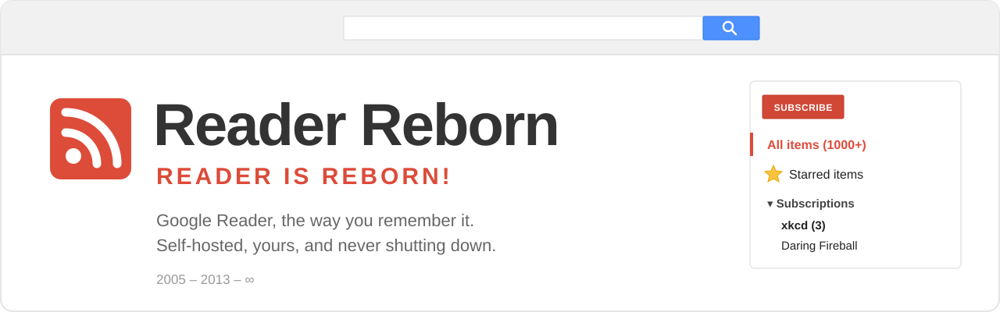
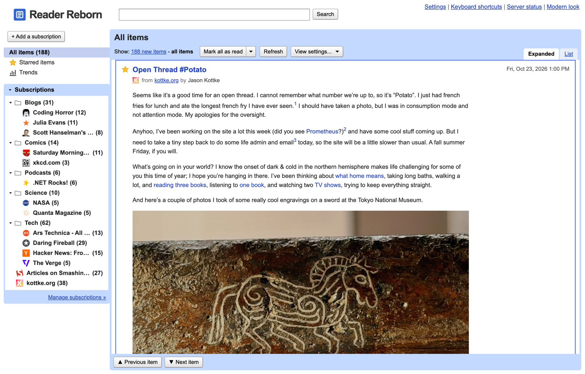
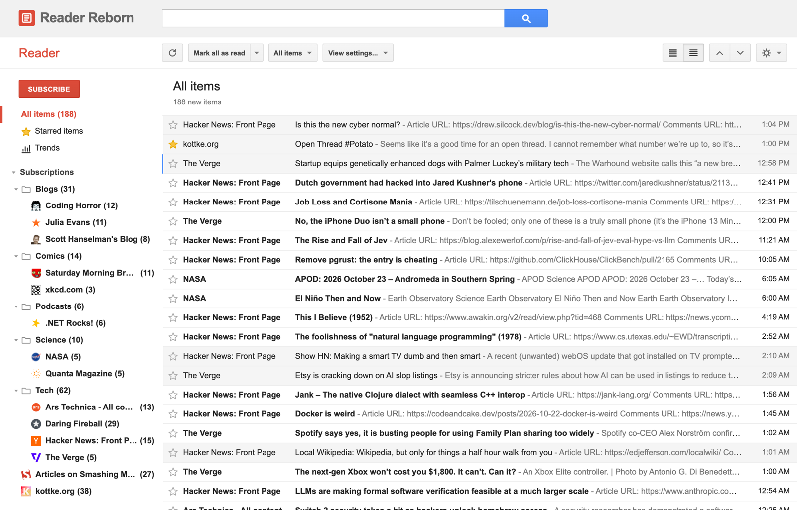
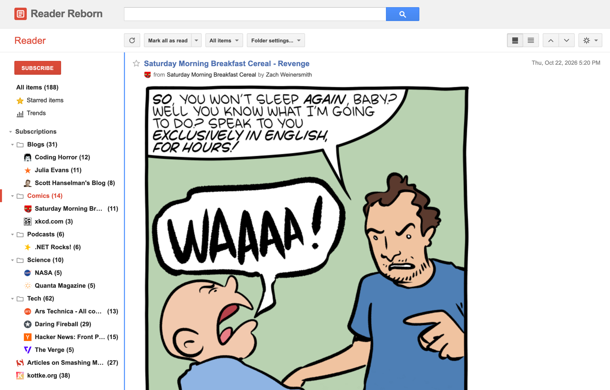
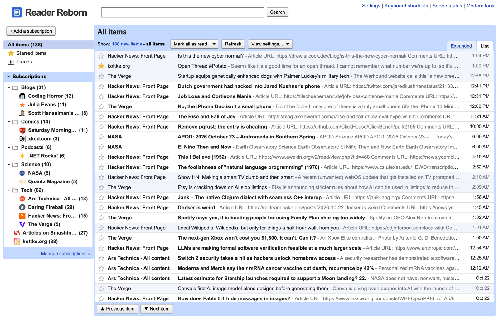
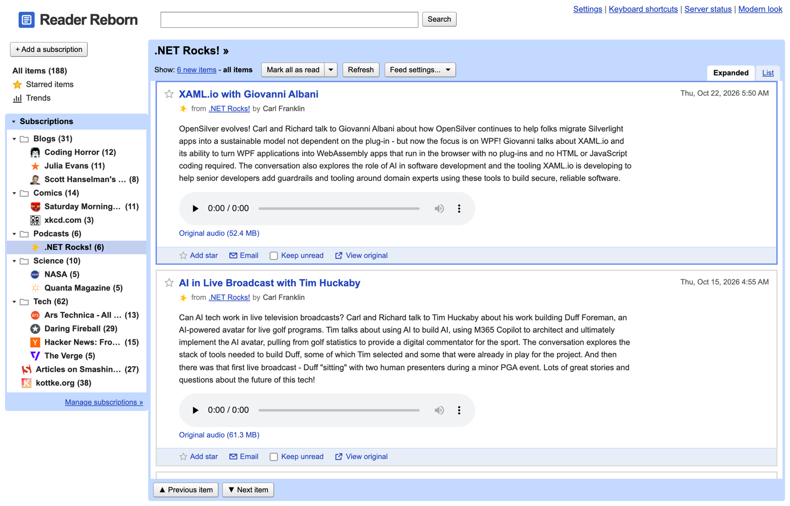
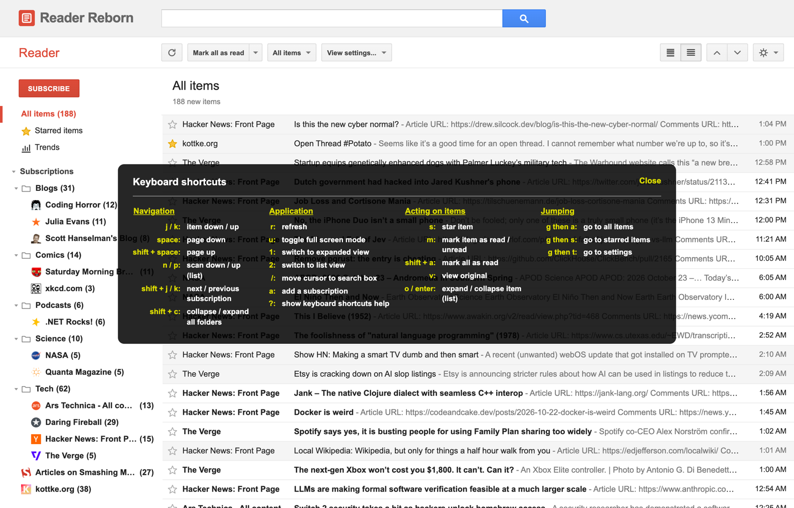
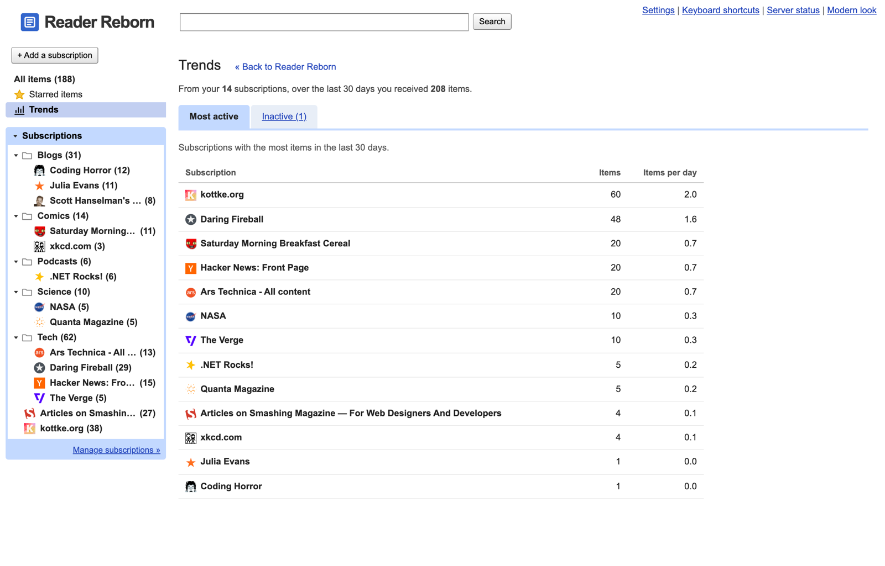
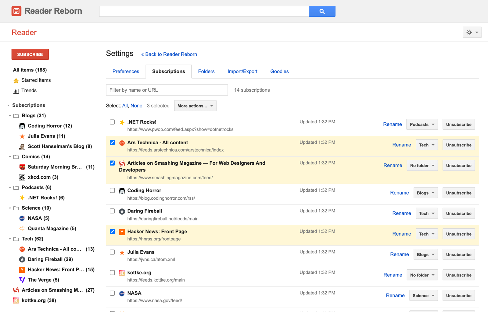
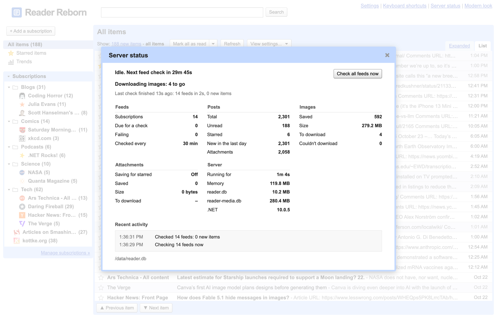

<p align="center">
  
</p>

<p align="center">
  <a href="https://github.com/mika76/reader-reborn/releases/latest"></a>
  
  
  
  
  
</p>

<p align="center"><b>Remember <code>All items (1000+)</code>? It's back.</b></p>

---

On **March 13, 2013**, Google announced that Reader would be shut down as part of a "spring cleaning". On **July 1, 2013**, it was gone, along with the little red **SUBSCRIBE** button, the `j` and `k` keys, and the quiet daily ritual of getting that unread count back to zero.

**Reader Reborn** brings it back. It's a faithful recreation of Google Reader's interface, in both of its looks, running on your own machine against your own feeds. There's no account to sign up for and no ads. Nobody can shut it down but you.

<p align="center">
  
  <br><sub>The Classic look, light blue, as it was from 2008 until the 2011 redesign.</sub>
</p>

## ✨ What's back

**It looks and feels like Reader**
- **Both looks**: Classic, the light blue one from 2008, and Modern, the grey-and-red 2011 redesign it had until the end. Switch any time.
- **Expanded and List views**, with posts marked read as they scroll past, just like you remember.
- **The keyboard shortcuts**: `j`/`k`, `n`/`p`, `o`, `s`, `m`, `v`, `shift+a`, `g a`, `?` and the rest. Your fingers still know them.
- **Star**, **Keep unread**, **Mark all as read** (including "older than a week"), New items / All items, sort by newest or oldest, and search.
- **Trends**: your most active subscriptions, and the ones that went quiet.
- **The "Subscribe..." bookmarklet**: drag it to your bookmarks bar and subscribe as you surf.

**It organises like Reader**
- **Folders that work like Reader's tags**: one feed can be in several.
- **Drag and drop** in the sidebar: move feeds between folders, or arrange feeds and folders in your own order.
- **Settings → Subscriptions**: check several feeds and use *More actions…* to unsubscribe or file them in bulk.

**It keeps what Reader couldn't**
- **Your posts stay**, even after they drop out of a feed.
- **Pictures are saved too**: every image in every post is downloaded, so posts keep their pictures when the original site goes away.
- **Podcasts and attachments** play right in the post. Optionally, the attachments of starred posts are saved for good.
- **Bring your 2013 Takeout**: import the `subscriptions.xml` and `starred.json` you downloaded before the lights went out. Your starred items come home, even from blogs that no longer exist.

**And a few things it didn't have**
- **Server status**: a live view of feed checks, image downloads, database sizes and recent activity, with a *Check all feeds now* button.
- **Runs anywhere**: one C# file, one Vue app, two SQLite files, and a container if you want one.

## 📸 Screenshots

<table>
  <tr>
    <td width="50%"><br><sub>The 2011 redesign, in list view.</sub></td>
    <td width="50%"><br><sub>Expanded view: the whole post, pictures and all.</sub></td>
  </tr>
  <tr>
    <td><br><sub>Classic, in list view.</sub></td>
    <td><br><sub>Podcasts play right in the post.</sub></td>
  </tr>
  <tr>
    <td><br><sub>Press <code>?</code>. You know the drill.</sub></td>
    <td><br><sub>Trends: who posts the most, and who went quiet.</sub></td>
  </tr>
  <tr>
    <td><br><sub>Managing subscriptions, several at a time.</sub></td>
    <td><br><sub>Server status, for those of us running our own.</sub></td>
  </tr>
</table>

## 🚀 Quick start

### With Docker or Podman

One command, nothing to build:

```bash
docker run -d --name reader-reborn -p 5199:5199 -v reader-reborn-data:/data ghcr.io/mika76/reader-reborn:latest
```

Then open **http://localhost:5199** and click **SUBSCRIBE**. Swap `docker` for `podman` if that's what you use. Images are published for Intel/AMD and ARM (Apple Silicon, Raspberry Pi) with every [release](https://github.com/mika76/reader-reborn/releases).

Your data lives in the `reader-reborn-data` volume. To upgrade, pull the new image and start a new container with the same volume.

<details>
<summary>With compose</summary>

Download [`compose.yaml`](compose.yaml), then:

```bash
docker compose up -d
```

`podman compose up -d` works the same way. To use another port, set `READER_PORT` (for example `READER_PORT=8080 docker compose up -d`). Other settings go under `environment:` in `compose.yaml`.
</details>

<details>
<summary>Moving an existing database into the container</summary>

First stop the Reader Reborn that uses it, so the databases aren't mid-write. Then copy the `data` folder into a stopped container:

```bash
docker create --name reader-reborn -p 5199:5199 -v reader-reborn-data:/data ghcr.io/mika76/reader-reborn:latest
```

```bash
docker cp data/. reader-reborn:/data/
```

```bash
docker start reader-reborn
```
</details>

<details>
<summary>Build it yourself</summary>

```bash
docker build -t reader-reborn .
```

```bash
docker run -d --name reader-reborn -p 5199:5199 -v reader-reborn-data:/data reader-reborn
```
</details>

### From source

You need the [.NET 10 SDK](https://dotnet.microsoft.com/download) and [Node.js 22](https://nodejs.org).

```bash
cd web && npm install && npm run build
```

```bash
./server/reader.cs
```

Then open **http://localhost:5199**. That's not a typo: the whole backend is a single C# file with a shebang. .NET 10 runs it directly, no project file needed.

For frontend work, run `npm run dev` in `web/`. It serves http://localhost:5173 and proxies `/api` to the backend.

## 📦 Coming home from Google Takeout

Still have the zip you downloaded in 2013? Unzip it and look in the `Reader` folder:

1. **`subscriptions.xml`**: go to **Settings → Import/Export** and upload it under *Import your subscriptions*. Your folders come along too.
2. **`starred.json`**: upload it under *Import your starred items*. Every star you ever gave comes back, even for blogs that no longer exist. Those are kept with your starred items without cluttering your subscriptions.

You can go the other way as well: export your subscriptions as OPML, and your starred items in the same `starred.json` format.

## ⌨️ Keyboard shortcuts

| Key | | Key | |
|---|---|---|---|
| `j` / `k` | next / previous item | `s` | star item |
| `n` / `p` | scan down / up (list view) | `m` | mark item read / unread |
| `o` / `enter` | expand / collapse item (list view) | `v` | view original |
| `space` / `shift+space` | page down / up | `shift+a` | mark all as read |
| `shift+j` / `shift+k` | next / previous subscription | `r` | refresh |
| `shift+c` | collapse / expand all folders\* | `u` | full screen (hide the sidebar) |
| `g` then `a` | go to all items | `1` / `2` | expanded / list view |
| `g` then `s` | go to starred items | `/` | search |
| `g` then `t` | go to settings\* | `a` | add a subscription |
| `?` | show all the shortcuts | | |

<sub>\* Not in the original.</sub>

## ⚙️ Configuration

Everything is set with environment variables, and all of them are optional.

| Variable | Default | What it does |
|---|---|---|
| `READER_DB` | `data/reader.db` | Where the database lives. `reader-media.db` goes next to it. |
| `READER_PORT` | `5199` | The port to serve on. |
| `READER_HOST` | `localhost` | The address to listen on. The container uses `0.0.0.0`. |
| `READER_INTERVAL` | `30` | Minutes between checks of each feed. |
| `READER_IMAGES` | on | Set to `off` to stop saving copies of post images. |
| `READER_WEB` | `web/dist` | Where the built frontend is. |

The server also has a few command-line modes:

```bash
./server/reader.cs add daringfireball.net       # subscribe; finds the feed from a site's address
./server/reader.cs import subscriptions.xml     # import OPML, e.g. from Google Takeout
./server/reader.cs fetch                        # check every feed and save new images once, then exit (for cron)
```

## 🔧 How it works

```
web/            Vue 3 + Vite: the Reader interface, both themes
server/reader.cs
                one C# file: feed downloader, image saver, JSON API, and it serves the frontend
data/reader.db         subscriptions, folders, posts, read and starred state
data/reader-media.db   saved images and attachments, each stored once by its SHA-256
```

- **Feeds:**
  - Reads RSS 0.9x, 2.0 and 1.0 (RDF), Atom, and YouTube / Media RSS.
  - Give it a site's address and it finds the feed.
  - Polite to the sites it reads:
    - It asks for a feed only if it has changed (ETag / Last-Modified), and skips re-reading identical downloads from servers that don't support that.
    - It waits longer when a feed or server says it can be cached (`Cache-Control`, `Expires`, RSS `<ttl>`), and checks quiet feeds less often, from every 30 minutes up to once a day.
    - It does as asked when a site says to slow down (`Retry-After` on 429 / 503), opens at most 2 connections per site, and backs off from feeds that keep failing.
    - It updates a feed's address when it has moved for good (301 / 308), and stops checking feeds whose site says they're gone (410).
- **Images and attachments:**
  - Downloaded in the background into the second database, so the main one stays small and quick to back up.
  - Checked by their actual bytes, not the server's say-so.
  - Served with headers that stop any scripts in them from running.
  - Identical files are stored once, and a copy is removed when no post uses it any more.
- **Your data is two SQLite files.** Back them up, copy them, open them in any SQLite tool. They're yours.

## ❓ FAQ

**Is this affiliated with Google?**
No. Reader Reborn is an independent, fan-made tribute. Google and Google Reader are trademarks of Google LLC.

**Does it sync with mobile apps?**
Not yet. Many apps speak the old Google Reader sync API (the "GReader API" that FreshRSS and Miniflux implement), and supporting it would be a great contribution.

**Can I run it for my whole family?**
It's single-user for now: there's no sign-in. Run it on your own machine, or behind something that adds authentication.

## 🤝 Contributing

Issues and pull requests are welcome. Bonus points for anything that makes it feel *more* like 2011. See the [roadmap](ROADMAP.md) for what's planned next. Before opening a pull request, make sure `npm run build` in `web/` and `dotnet build server/reader.cs` both pass. The [GitHub Actions build](.github/workflows/build.yml) checks both, plus the container.

**Releasing** (for maintainers): bump `AppInfo.Version` in `server/reader.cs` and `version` in `web/package.json`, add a section to [`CHANGELOG.md`](CHANGELOG.md), then push a tag like `v1.0.1`. The [release workflow](.github/workflows/release.yml) publishes the image to `ghcr.io` and creates the GitHub release from the changelog.

## 💌 In memory of Google Reader

**October 7, 2005 – July 1, 2013.**

To the team who built it: it was the best way to read the web, and a lot of us never quite found anything like it again. This one's for you.

## License

[MIT](LICENSE)
